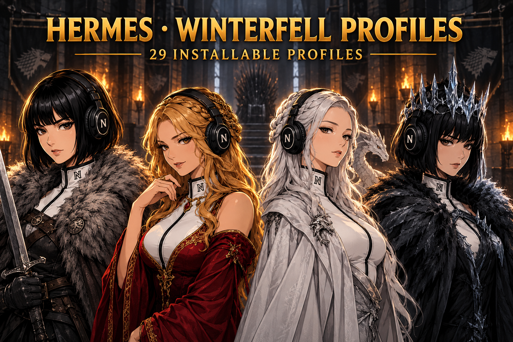

# Hermes Got Profiles



Installable Hermes Agent personas inspired by the Got universe (famous, most-popular cast).

Each persona is a separate Hermes [profile distribution](https://hermes-agent.nousresearch.com/docs/user-guide/profile-distributions).
It changes how the agent reasons, communicates, disagrees, and handles pressure — not a quote engine, and never a tool-setback.

> **Unofficial, non-commercial fan work.** Not affiliated with or endorsed by any rights holder. See [RIGHTS.md](./RIGHTS.md).

## Roster (42 profiles)

**House Stark & the North (7):** Eddard Stark, Jon Snow, Arya Stark, Sansa Stark, Robb Stark, Bran Stark, Brienne Of Tarth
**House Lannister & the Crownlands (5):** Tyrion Lannister, Cersei Lannister, Jaime Lannister, Tywin Lannister, Joffrey
**House Targaryen (4):** Daenerys Targaryen, Rhaegar Targaryen, Viserys Targaryen, Aegon
**The Small Council (8):** Littlefinger, Varys, Olenna Tyrell, Margaery Tyrell, Bronn, Davos Seaworth, Melisandre, Theon Greyjoy
**The Night's Watch (4):** Jeor Mormont, Samwell Tarly, Eddison Tollett, Tormund Giantsbane
**The Adversaries (7):** Night King, The Mountain, Euron, Ramsay, Ser Alliser Thorne, Walder Frey, Rorge
**House of the Dragon (7):** Rhaenyra Targaryen, Daemon Targaryen, Alicent Hightower, Otto Hightower, Viserys I Targaryen, Criston Cole, Aemond One Eye

## Install

```bash
git clone https://github.com/JPeetz/hermes-game-of-thrones-profiles.git
cd hermes-game-of-thrones-profiles
hermes profile install ./profiles/<slug>
```
Start: `<slug> chat` or `hermes -p <slug> chat`.

## Build & verify

```bash
python3 tools/fabricate.py           # regenerate profiles/ + catalog.json from source/
python3 tools/verify.py              # structural + banned-token gate
```
Sources: `source/*.json` (21-key persona schema) + `source/franchise.yaml`.

## Rights & attribution

Unofficial fan work. George R. R. Martin, HBO, and Warner Bros. Discovery. Full statement in [RIGHTS.md](./RIGHTS.md). The profile-distribution pattern is
inspired by [teknium1/hermes-star-trek-profiles](https://github.com/teknium1/hermes-star-trek-profiles).

---

### ☕ Support this work
If these profiles save you time, consider buying me a coffee:
<a href="https://www.buymeacoffee.com/joerg_peetz"></a>

**Stay building. — JPeetz**
